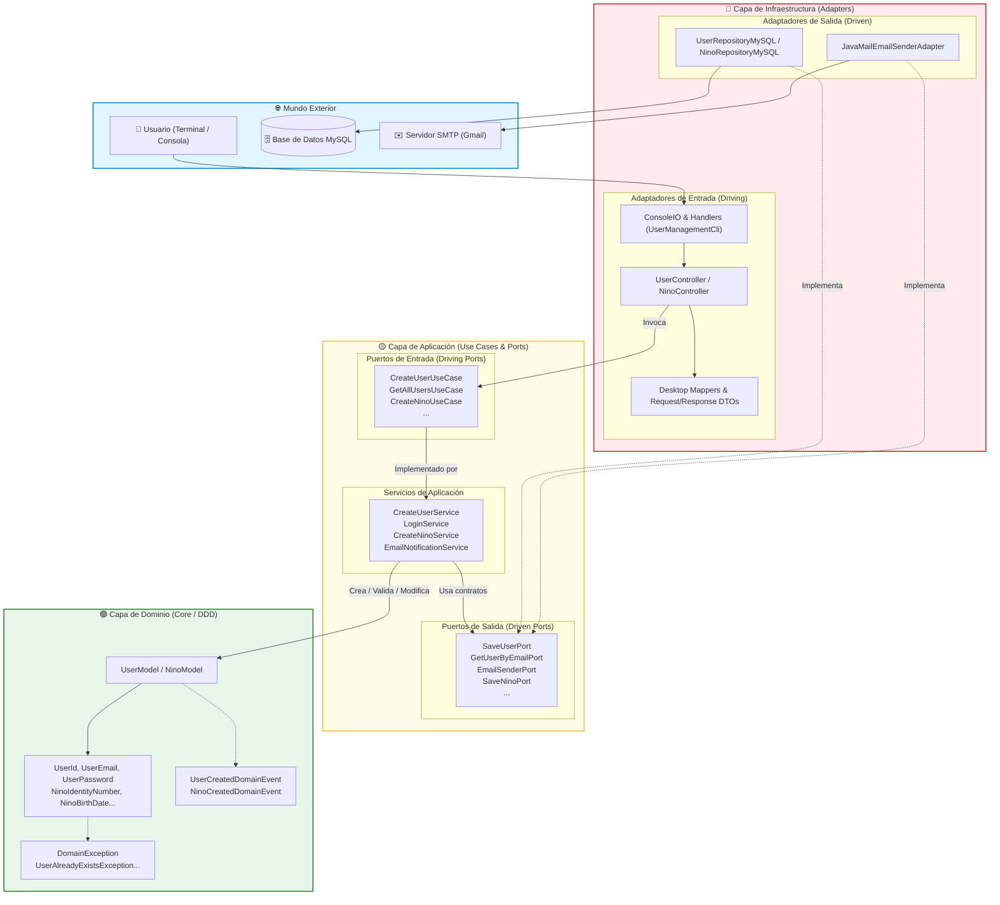
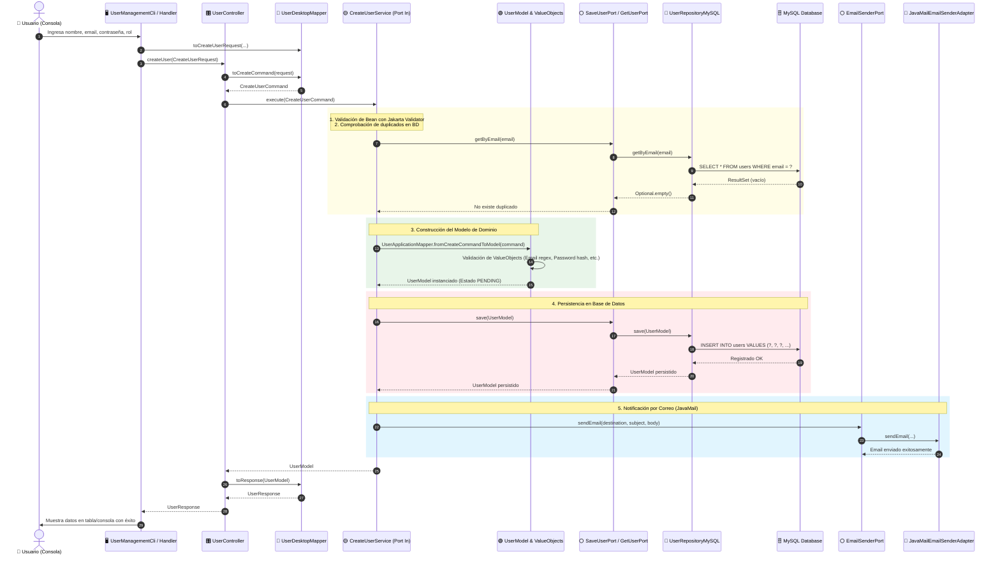

# 🏛️ Users Management Desktop - Arquitectura Hexagonal y DDD

> **Proyecto Académico / Profesional** para la Universidad de Cartagena (UdeC)  
> Sistema de escritorio en **Java 17** enfocado en la gestión integral de **Usuarios** y **Niños**, implementado bajo los principios de **Arquitectura Hexagonal (Ports & Adapters)**, **Domain-Driven Design (DDD)** y **Clean Code**.

---

## 📋 Tabla de Contenidos

1. [Visión General](#-visión-general)
2. [Fundamentos de la Arquitectura Hexagonal](#-fundamentos-de-la-arquitectura-hexagonal)
3. [Estructura del Proyecto y Capas](#-estructura-del-proyecto-y-capas)
4. [Diagramas de Comunicación entre Capas](#-diagramas-de-comunicación-entre-capas)
   - [Diagrama Hexagonal Global](#1-diagrama-hexagonal-global)
   - [Diagrama de Secuencia: Flujo Paso a Paso de una Petición](#2-diagrama-de-secuencia-flujo-paso-a-paso-de-una-petición)
   - [Regla de Dependencias (Inversión de Control)](#3-regla-de-dependencias-inversión-de-control)
5. [Explicación Paso a Paso del Flujo de Ejecución](#-explicación-paso-a-paso-del-flujo-de-ejecución)
6. [Conceptos de Domain-Driven Design (DDD) Implementados](#-conceptos-de-domain-driven-design-ddd-implementados)
7. [Inyección de Dependencias Pura (Pure Java DI)](#-inyección-de-dependencias-pura-pure-java-di)
8. [Requisitos y Configuración](#-requisitos-y-configuración)
9. [Compilación, Pruebas y Ejecución](#-compilación-pruebas-y-ejecución)

---

## 🎯 Visión General

El propósito principal de este proyecto es demostrar cómo estructurar un software desacoplado, mantenible y testeable sin depender de frameworks mágicos o pesados (como Spring Boot). Toda la arquitectura se sostiene en código Java puro, aplicando:

- **Arquitectura Hexagonal (Puertos y Adaptadores)** formulada por Alistair Cockburn.
- **Diseño Guiado por el Dominio (DDD)** formulado por Eric Evans.
- **Principios SOLID** (en especial Inversión de Dependencias y Responsabilidad Única).
- **Inmutabilidad y Validación de Invariantes** mediante *Value Objects* y *Jakarta Bean Validation*.
- **Persistencia desacoplada** con JDBC nativo sobre MySQL.
- **Notificaciones por correo** con JavaMail SMTP asíncrono/desacoplado.

---

## 🧩 Fundamentos de la Arquitectura Hexagonal

La **Arquitectura Hexagonal**, también conocida como patrón de **Puertos y Adaptadores (Ports and Adapters)**, tiene un objetivo central:  
**Aislar la lógica de negocio (Dominio) de cualquier tecnología externa o detalle de infraestructura.**

```
+---------------------------------------------------------------------------------+
|                                 INFRAESTRUCTURA                                 |
|                                                                                 |
|   [ Adaptador Primario ]                               [ Adaptador Secundario ] |
|   (CLI / Controlador)                                  (MySQL / Repositorio)    |
|             |                                                    ^              |
|             v                                                    |              |
|       +----------------------------------------------------+     |              |
|       |                     APLICACIÓN                     |     |              |
|       |                                                    |     |              |
|       |   [ Puerto In ]                     [ Puerto Out ]-+-----+              |
|       |   (Caso de Uso)                     (Interfaz SPI)                      |
|       |         |                                 ^                             |
|       |         v                                 |                             |
|       |       +-------------------------------------+                           |
|       |       |               DOMINIO               |                           |
|       |       |  - Entidades y Agregados            |                           |
|       |       |  - Value Objects (Invariantes)      |                           |
|       |       |  - Excepciones y Reglas de Negocio  |                           |
|       |       +-------------------------------------+                           |
|       +----------------------------------------------------+                    |
+---------------------------------------------------------------------------------+
```

### Conceptos Clave:

1. **El Núcleo (Dominio):** No conoce bases de datos, APIs, consolas, librerías de UI ni protocolos de red. Es código Java puro.
2. **Puertos de Entrada (Driving / Primary Ports):** Interfaces que declaran **qué puede hacer el exterior con la aplicación** (Casos de Uso).
3. **Puertos de Salida (Driven / Secondary Ports):** Interfaces que declaran **qué necesita la aplicación del exterior** (Persistencia, Envío de Correos, Logs).
4. **Adaptadores de Entrada (Driving Adapters):** Componentes que capturan eventos del mundo exterior y llaman a los Puertos de Entrada (p. ej., interfaz de consola CLI, controladores desktop, REST controllers).
5. **Adaptadores de Salida (Driven Adapters):** Clases que implementan los Puertos de Salida comunicándose con tecnologías concretas (p. ej., `UserRepositoryMySQL`, `JavaMailEmailSenderAdapter`).

---

## 📂 Estructura del Proyecto y Capas

El código está organizado dentro del paquete `com.jcaa.usersmanagement` siguiendo estrictamente la separación hexagonal:

```
src/main/java/com/jcaa/usersmanagement/
│
├── Main.java                                   # Punto de arranque y arranque del CLI
│
├── domain/                                     # 🟢 CAPA 1: NÚCLEO DE DOMINIO (Reglas de Negocio)
│   ├── model/                                  # Entidades y Agregados (UserModel, NinoModel, Persona)
│   ├── valueobject/                            # Objetos de Valor inmutables (UserId, UserEmail, NinoName...)
│   ├── enums/                                  # Enumeraciones de dominio (UserRole, UserStatus)
│   ├── event/                                  # Eventos de dominio (UserCreatedDomainEvent, NinoCreated...)
│   └── exception/                              # Excepciones de negocio (UserAlreadyExistsException...)
│
├── application/                                # 🟡 CAPA 2: APLICACIÓN (Casos de Uso)
│   ├── port/
│   │   ├── in/                                 # Puertos de Entrada (CreateUserUseCase, GetAllNinosUseCase...)
│   │   └── out/                                # Puertos de Salida (SaveUserPort, EmailSenderPort...)
│   └── service/                                # Servicios que implementan los casos de uso
│       ├── CreateUserService.java
│       ├── EmailNotificationService.java
│       ├── dto/command/                        # Comandos de entrada (CreateUserCommand, LoginCommand...)
│       ├── dto/query/                          # Consultas de lectura (GetUserByIdQuery...)
│       └── mapper/                             # Mapeo entre DTOs de aplicación y modelos de dominio
│
└── infrastructure/                             # 🔴 CAPA 3: INFRAESTRUCTURA (Detalles Técnicos)
    ├── config/                                 # Contenedor de Inyección de Dependencias y configuración
    │   ├── DependencyContainer.java            # Ensamblador de todas las capas (IoC manual)
    │   ├── AppProperties.java                  # Lector de application.properties
    │   └── ValidatorProvider.java              # Validador Jakarta
    │
    ├── entrypoint/desktop/                     # Adaptadores de Entrada (Driving)
    │   ├── cli/                                # Menú de consola interactivo y handlers
    │   │   ├── UserManagementCli.java
    │   │   ├── handler/                        # CreateUserHandler, LoginHandler, CreateNinoHandler...
    │   │   └── io/                             # ConsoleIO, formateadores de salida
    │   ├── controller/                         # UserController, NinoController
    │   ├── dto/                                # CreateUserRequest, UserResponse, NinoResponse...
    │   └── mapper/                             # UserDesktopMapper, NinoDesktopMapper
    │
    └── adapter/                                # Adaptadores de Salida (Driven)
        ├── persistence/                        # Adaptador de persistencia MySQL
        │   ├── repository/                     # UserRepositoryMySQL, NinoRepositoryMySQL
        │   ├── entity/                         # UserEntity, NinoEntity (modelo de base de datos)
        │   ├── mapper/                         # UserPersistenceMapper, NinoPersistenceMapper
        │   └── config/                         # DatabaseConnectionFactory, DatabaseConfig
        └── email/                              # Adaptador de correo electrónico
            ├── JavaMailEmailSenderAdapter.java # Implementación de EmailSenderPort con JavaMail
            └── SmtpConfig.java
```

---

## 📊 Diagramas de Comunicación entre Capas

### 1. Diagrama Hexagonal Global

El siguiente diagrama muestra la interacción entre los actores externos, adaptadores y el núcleo del sistema:



---

### 2. Diagrama de Secuencia: Flujo Paso a Paso de una Petición

A continuación se muestra el ciclo de vida completo al registrar un usuario (`CreateUser`), desde que el usuario teclea en el CLI hasta la persistencia y la notificación por correo:



---

### 3. Regla de Dependencias (Inversión de Control)

Uno de los principios inviolables de la Arquitectura Hexagonal es la **Regla de Dependencia**:

> **Las dependencias de código fuente solo deben apuntar hacia adentro (hacia el Dominio).**

```
 [ INFRAESTRUCTURA ] ─────────► [ APLICACIÓN ] ─────────► [ DOMINIO ]
 (Depende de Aplicación y Dominio)       (Depende de Dominio)       (NO DEPENDE DE NADIE)
```

- El **Dominio** no importa ningún paquete de `application` ni de `infrastructure`.
- La **Aplicación** importa únicamente `domain`.
- La **Infraestructura** conoce a `application` y a `domain`, pero implementa las interfaces que ellas definieron.

---

## 👣 Explicación Paso a Paso del Flujo de Ejecución

Para comprender exactamente cómo dialogan las capas en este proyecto, analicemos el recorrido de la información paso a paso:

### Paso 1: Entrada del Usuario en la Capa de Infraestructura
- El usuario interactúa mediante la consola a través de `UserManagementCli`.
- El handler correspondiente (p. ej., `CreateUserHandler` o `CreateNinoHandler`) recolecta los datos ingresados a través de `ConsoleIO`.
- Se empaquetan los datos crudos en un DTO de presentación: `CreateUserRequest`.

### Paso 2: Delegación al Controlador
- El handler invoca al método `userController.createUser(request)`.
- El controlador utiliza `UserDesktopMapper` para transformar el `CreateUserRequest` en un comando de la capa de aplicación: `CreateUserCommand`.

### Paso 3: Cruce del Hexágono mediante el Puerto de Entrada
- El controlador llama a `createUserUseCase.execute(command)`.
- `CreateUserUseCase` es una **interfaz** (Puerto de Entrada). El controlador no sabe qué clase lo implementa; solo conoce su contrato.

### Paso 4: Ejecución en el Servicio de Aplicación
- `CreateUserService` recibe el comando y realiza:
  1. **Validación estructural**: Ejecuta `ValidatorProvider` (Jakarta / Hibernate Validator) sobre las anotaciones `@NotBlank`, `@Email`, etc., del comando.
  2. **Regla de Negocio (Unicidad)**: Llama al puerto de salida `GetUserByEmailPort.getByEmail(...)` para garantizar que el correo no esté registrado.
  3. Si ya existe, lanza la excepción de dominio `UserAlreadyExistsException`.

### Paso 5: Construcción de Entidades y Value Objects de Dominio
- Mediante `UserApplicationMapper`, se instancia el modelo `UserModel`.
- Al crear el modelo, se crean sus **Value Objects**:
  - `UserId`: Genera o valida un UUID válido.
  - `UserEmail`: Comprueba el formato de correo electrónico.
  - `UserPassword`: Aplica las políticas de contraseñas y realiza el hashing con **BCrypt**.
  - `UserName`: Garantiza que el nombre cumpla con la longitud y caracteres permitidos.
- Si alguna regla se incumple, el propio Value Object interrumpe el flujo con una excepción de dominio específica (p. ej., `InvalidUserPasswordException`).

### Paso 6: Persistencia a través del Puerto de Salida
- El servicio de aplicación no sabe qué base de datos se utiliza. Solo llama al método:
  ```java
  final UserModel savedUser = saveUserPort.save(userToSave);
  ```
- `SaveUserPort` es una interfaz (Puerto de Salida).

### Paso 7: El Adaptador de Persistencia ejecuta la operación física
- La clase `UserRepositoryMySQL` (Adaptador de Salida) implementa `SaveUserPort`.
- Convierte el `UserModel` a `UserPersistenceDto` usando `UserPersistenceMapper`.
- Utiliza una conexión `java.sql.Connection` creada por `DatabaseConnectionFactory` y ejecuta una sentencia SQL parametrizada (`PreparedStatement`) para prevenir inyecciones SQL.

### Paso 8: Efectos Colaterales (Notificaciones)
- El servicio invoca a `EmailNotificationService`, el cual usa el puerto `EmailSenderPort`.
- El adaptador `JavaMailEmailSenderAdapter` implementa dicho puerto, conectándose por SMTP a Gmail y enviando una plantilla HTML (`user-created.html`).

### Paso 9: Retorno de la Respuesta
- El `UserModel` resultante viaja de vuelta desde el servicio hacia el controlador.
- El controlador lo convierte a un `UserResponse` mediante `UserDesktopMapper`.
- El handler utiliza `UserResponsePrinter` para mostrar en pantalla los datos formateados de forma amigable.

---

## 🏛️ Conceptos de Domain-Driven Design (DDD) Implementados

| Concepto DDD | Ubicación en el Proyecto | Responsabilidad |
|---|---|---|
| **Entidad / Aggregate Root** | `UserModel`, `NinoModel` | Objetos con identidad propia a lo largo del tiempo. Contienen reglas de ciclo de vida (`activate()`, `deactivate()`, `discharge()`). |
| **Value Objects (VO)** | `UserEmail`, `UserPassword`, `UserId`, `NinoBirthDate`, `NinoAdmissionDate` | Objetos inmutables sin identidad propia. Se autovalidan al construirse para garantizar invariantes de negocio. |
| **Domain Events** | `UserCreatedDomainEvent`, `NinoUpdatedDomainEvent` | Notifican a otros componentes o subsistemas que un hecho relevante ha ocurrido en el dominio. |
| **Domain Exceptions** | `DomainException`, `UserNotFoundException`, `InvalidNinoAdmissionDateException` | Errores semánticos propios del negocio, desacoplados de fallos de red o base de datos. |
| **Domain Services** | `EmailNotificationService` | Lógica de orquestación de negocio que no pertenece a una sola entidad. |

---

## 🔌 Inyección de Dependencias Pura (Pure Java DI)

Este proyecto no utiliza frameworks invasivos como Spring o Guice. En su lugar, utiliza un contenedor de dependencias manual y limpio:

📁 `com.jcaa.usersmanagement.infrastructure.config.DependencyContainer`

```java
// Ejemplo de cableado manual en DependencyContainer:
final Connection connection = buildDatabaseConnection(properties);
final UserRepositoryMySQL userRepository = new UserRepositoryMySQL(connection);
final JavaMailEmailSenderAdapter emailSender = new JavaMailEmailSenderAdapter(buildSmtpConfig(properties));
final EmailNotificationService emailNotification = new EmailNotificationService(emailSender);
final Validator validator = ValidatorProvider.buildValidator();

// Inyección de puertos hacia los casos de uso:
final CreateUserUseCase createUserUseCase =
    new CreateUserService(userRepository, userRepository, emailNotification, validator);

// Inyección de casos de uso hacia los controladores:
this.userController = new UserController(createUserUseCase, ...);
```

**Ventajas:**
1. **Arranque instantáneo:** Cero sobrecarga de escaneo de anotaciones por reflexión.
2. **Determinismo:** El flujo de construcción es explícito y fácil de depurar paso a paso.
3. **Testeabilidad extrema:** Para pruebas unitarias basta con pasar un `mock` por constructor sin cargar contextos pesados.

---

## ⚙️ Requisitos y Configuración

### Requisitos Previos:
- **Java Development Kit (JDK):** Versión 17 o superior.
- **Apache Maven:** 3.8+ instalado y configurado en el `PATH`.
- **MySQL Server:** 8.0 o superior en ejecución.

### 1. Configuración de Base de Datos:
Ejecuta el script SQL incluido en el proyecto para crear la base de datos y sus tablas:
```bash
mysql -u root -p < src/main/resources/schema.sql
```

El script creará:
- La base de datos `crud_usuarios`.
- La tabla `users` con un usuario administrador precargado (`admin@example.com`).
- La tabla `ninos` con las columnas requeridas para el control de admisiones.

### 2. Configuración de la Aplicación:
Edita el archivo [application.properties](file:///src/main/resources/application.properties):

```properties
# =============================================
# Configuración de Base de Datos MySQL
# =============================================
db.host=127.0.0.1
db.port=3306
db.name=crud_usuarios
db.username=root
db.password=tu_password

# =============================================
# Configuración SMTP (JavaMail)
# =============================================
smtp.host=smtp.gmail.com
smtp.port=587
smtp.username=tu_correo@gmail.com
smtp.password=tu_token_de_aplicacion
smtp.from.address=tu_correo@gmail.com
smtp.from.name=Gestión de Usuarios
```

> [!NOTE]
> Para el envío de correos con Gmail, debes generar una **Contraseña de Aplicación** desde la configuración de seguridad de tu cuenta Google.

---

## 🚀 Compilación, Pruebas y Ejecución

### 1. Compilar y ejecutar pruebas unitarias:
```bash
mvn clean test
```

### 2. Empaquetar el proyecto en un archivo JAR:
```bash
mvn clean package
```

### 3. Ejecutar la aplicación:
```bash
mvn exec:java -Dexec.mainClass="com.jcaa.usersmanagement.Main"
```
O directamente con el JAR compilado:
```bash
java -jar target/users-management-1.4.jar
```

---

## 👥 Menú de Funcionalidades en Consola

Al iniciar la aplicación, se presenta la interfaz de consola interactiva:

```text
==========================================
     Users Management System
==========================================
  1. Iniciar Sesión (Login)
  2. Listar todos los usuarios
  3. Buscar usuario por ID
  4. Crear nuevo usuario
  5. Actualizar usuario
  6. Eliminar usuario
  ------------------------------------------
  7. Listar todos los niños
  8. Buscar niño por documento de identidad
  9. Registrar nuevo niño
  10. Actualizar niño
  11. Dar de baja / Eliminar niño
  ------------------------------------------
  0. Salir
==========================================
```

---

## 📚 Conclusión Pedagógica

Este proyecto demuestra que la **Arquitectura Hexagonal** y el diseño **DDD** no son exclusivos de aplicaciones web complejas o microservicios. Aplicados a una aplicación de consola en Java, proporcionan:

- **Independencia tecnológica:** Mañana se puede cambiar la consola por una GUI en JavaFX o una API REST en Spring Web sin tocar una sola línea de la capa de `dominio` ni de `aplicación`.
- **Independencia de base de datos:** Se puede reemplazar MySQL por PostgreSQL o MongoDB cambiando únicamente el adaptador en `infrastructure/adapter/persistence`.
- **Mantenibilidad y Calidad:** El código es limpio, expresivo y fácil de entender y evolucionar.
